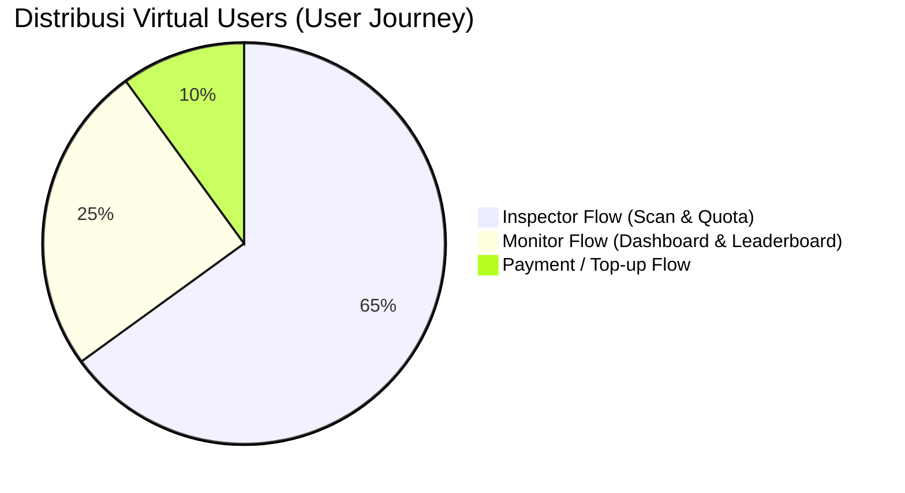

# CeraScan: Endpoint Load Analysis & Performance Testing Plan

Dokumen ini memetakan analisis beban setiap endpoint pada arsitektur **CeraScan Backend (Express + gRPC ML + Redis + RabbitMQ/Kafka + MySQL + MongoDB)** untuk kebutuhan *performance testing* (menggunakan k6 / Locust / Autocannon). 

Dokumen ini menjadi dasar empiris untuk memvalidasi efektivitas arsitektur *event-driven* dan *layered architecture* dalam menangani lonjakan trafik berskala produksi.

---

## 1. Klasifikasi Tingkat Beban Endpoint (Traffic Tiers)

```
                    ┌──────────────────────────────────────────────┐
                    │          Total Incoming Traffic              │
                    └──────────────────────┬───────────────────────┘
                                           │
         ┌─────────────────────────────────┼─────────────────────────────────┐
         ▼                                 ▼                                 ▼
   [ TIER 1: READ-HEAVY ]        [ TIER 2: WRITE / COMPUTE ]       [ TIER 3: PERSISTENT ]
   Volume: 65 - 75% RPS          Volume: 15 - 25% RPS              Volume: Long-Lived Streams
   Target: Latency < 50ms        Target: Throughput & Queue        Target: Connection Limits
   Focus: Redis & DB Index       Focus: Multipart & Broker         Focus: File Descriptors
```

---

## 2. Rincian Analisis per Endpoint

### TIER 1: High-Concurrency Read & Cache Saturation (Paling Ramai)
Endpoint-endpoint ini menerima volume request tertinggi saat pengguna berinteraksi dengan visualisasi data, monitoring pabrik, dan polling berkala.

| Method & Path | Subsistem yang Dilibatkan | Perilaku Beban | Risiko Bottleneck & Failure Mode | Target KPI (Under Load) |
| :--- | :--- | :--- | :--- | :--- |
| `GET /api/dashboard/kpi` | Express $\rightarrow$ Redis Cache $\rightarrow$ Fallback: MongoDB Aggregation | Sangat Tinggi (Setiap buka web / auto-refresh 30s) | **Cache Stampede**: Jika key Redis expired bersamaan saat 500 VUs request, MongoDB aggregations akan spiked CPU 100%. | Hit Redis: < 25ms<br>Miss: < 250ms<br>p95: < 50ms |
| `GET /api/dashboard/scan-trends` | Express $\rightarrow$ Redis Cache $\rightarrow$ Fallback: MongoDB Timeseries Query | Tinggi (Grafik tren 7 hari) | Ukuran payload JSON lumayan besar jika data titik harian padat. Cache miss berat di DB scan query. | Hit Redis: < 30ms<br>Miss: < 300ms<br>p95: < 60ms |
| `GET /api/leaderboards` | Express $\rightarrow$ Redis (`ZREVRANGE`) | Sangat Tinggi (Gamifikasi / Ranking operator) | Operasi sangat cepat di Redis in-memory, tetapi koneksi pool Redis bisa jenuh jika tidak reuse client. | p95: < 15ms<br>Throughput: > 1.500 RPS |
| `GET /api/user-quotas/me` | Express $\rightarrow$ Redis Hash $\rightarrow$ Fallback: MySQL `user_quotas` | Sangat Tinggi (Sebelum tiap upload gambar) | Quota dicek berulang-ulang. Jika cache miss, pool koneksi MySQL cepat habis (*starvation*). | p95: < 20ms |
| `GET /api/scans/history` | Express $\rightarrow$ MySQL `scans` table (Pagination `limit/offset`) | Tinggi (Browsing arsip hasil scan) | Full-table scan di MySQL jika index `user_id` + `created_at` tidak optimal pada jutaan baris. | p95: < 120ms |
| `GET /api/model-insights/kpi` | Express $\rightarrow$ MongoDB Aggregation (Class distribution) | Sedang - Tinggi (Halaman analitik AI) | CPU-bound query MongoDB. Harus dilindungi caching periodik. | p95: < 150ms |

---

### TIER 2: Compute & I/O Intensive (Paling Rawan Bottleneck)
Endpoint inti untuk upload gambar keramik. Menangani payload biner besar, I/O jaringan eksternal (Cloudflare R2), dan publish event ke message broker.

| Method & Path | Subsistem yang Dilibatkan | Perilaku Beban | Risiko Bottleneck & Failure Mode | Target KPI (Under Load) |
| :--- | :--- | :--- | :--- | :--- |
| `POST /api/scans/analyze` *(Single Upload)* | Express Multer (RAM Buffer) $\rightarrow$ Cloudflare R2 Upload $\rightarrow$ MySQL Insert $\rightarrow$ RabbitMQ `scan.process` | Sedang - Tinggi (Core action pengguna) | 1. **RAM OOM**: Buffer file gambar di memory Express jika ratusan request upload serentak.<br>2. **Network Saturation**: Upload ke R2 memakan bandwidth outbound VPS.<br>3. **Broker Backpressure**: RabbitMQ menumpuk pesan jika Python inference lambat. | Status 202: < 300ms<br>(Total background inference: < 1.5s) |
| `POST /api/scans/batch` *(Up to 50 Images)* | Multer Arrays $\rightarrow$ Multi-file R2 Uploads $\rightarrow$ MySQL Batch Insert $\rightarrow$ Batch RabbitMQ | Burst Spike (Batch drop dari lini produksi) | **Memory Spike Masif**: Mengunggah 50 gambar @ 2MB = 100MB per request. 10 request bersamaan = 1GB RAM terpakai mendadak. | Status 202: < 1.2s<br>Error rate: < 0.5% |

---

### TIER 3: Long-Lived Persistent Streaming (Kapasitas Koneksi)
Digunakan untuk *real-time push updates* dari status inferensi scan AI kembali ke antarmuka React.

| Method & Path | Subsistem yang Dilibatkan | Perilaku Beban | Risiko Bottleneck & Failure Mode | Target KPI (Under Load) |
| :--- | :--- | :--- | :--- | :--- |
| `GET /api/sse/events` | Express EventStream $\rightarrow$ Redis Pub/Sub listener | Koneksi tahan lama (*idle open socket*) | 1. **File Descriptor Limit**: Maksimum concurrent sockets OS/Nginx tercapai (`ulimit -n`).<br>2. **Response Buffering**: Proxy Nginx menahan buffer jika header `X-Accel-Buffering: no` gagal dihormati.<br>3. **Memory Leaks**: Event emitter listener menumpuk jika client disconnect tidak dibersihkan. | Menampung 1.000 concurrent SSE connections tanpa kenaikan memory linear |

---

### TIER 4: Transactional & Identity Workflows (Sensitif & Kritis)
Frekuensi lebih rendah dibandingkan scanning dan viewing, tetapi integritas data dan keamanan wajib 100%.

| Method & Path | Subsistem yang Dilibatkan | Perilaku Beban | Risiko Bottleneck & Failure Mode | Target KPI (Under Load) |
| :--- | :--- | :--- | :--- | :--- |
| `POST /api/auth/login` | Express $\rightarrow$ Bcrypt compare $\rightarrow$ JWT sign $\rightarrow$ Redis session | Spike saat jam masuk kerja pabrik | Bcrypt hashing adalah operasi **CPU-bound murni**. Lonjakan login bersamaan bisa mengunci event loop Node.js. | p95: < 150ms |
| `POST /api/payment/checkout` | Express $\rightarrow$ Midtrans Snap API $\rightarrow$ MySQL `payments` | Rendah | Dependensi ke latency gateway Midtrans pihak ketiga. | p95: < 600ms |
| `POST /api/payment/webhook` | Express $\rightarrow$ Idempotency check $\rightarrow$ MySQL update $\rightarrow$ Redis Quota Sync $\rightarrow$ Socket Broadcast | Rendah - Sedang (Trigger otomatis Midtrans) | **Race Condition / Double Credit**: Dua webhook event simultan untuk order yang sama harus dicegah secara idempoten di database. | p95: < 80ms<br>Error rate: 0.0% |

---

## 3. Skenario Profil User Journey (Weighted Traffic)

Dalam simulasi skala besar (misal 500 Virtual Users), distribusi skenario dibagi sesuai proporsi dunia nyata:



### User Journey A: "The Factory Inspector" (Bobot: 65%)
1. `POST /api/auth/login` $\rightarrow$ Simpan token JWT.
2. `GET /api/user-quotas/me` $\rightarrow$ Validasi sisa kuota harian.
3. `GET /api/sse/events` $\rightarrow$ Buka stream SSE untuk menerima notifikasi.
4. `POST /api/scans/analyze` $\rightarrow$ Kirim sample tile keramik (multipart).
5. Tunggu notifikasi hasil scan via SSE (atau fallback polling ke `GET /api/scans/history?limit=1`).
6. *Pacing (Think Time):* 2 - 5 detik antar operasi.

### User Journey B: "The Plant Manager / Dashboard Viewer" (Bobot: 25%)
1. `POST /api/auth/login`.
2. `GET /api/dashboard/kpi` $\rightarrow$ Baca status defect rate & total scan.
3. `GET /api/dashboard/scan-trends` $\rightarrow$ Baca timeseries harian.
4. `GET /api/model-insights/kpi` $\rightarrow$ Cek akurasi model & distribusi anomali.
5. `GET /api/leaderboards` $\rightarrow$ Cek produktivitas operator.
6. *Pacing (Think Time):* 10 - 20 detik (auto refresh dashboard).

### User Journey C: "The Quota Purchaser" (Bobot: 10%)
1. `GET /api/plans` $\rightarrow$ Ambil opsi paket upgrade.
2. `POST /api/payment/checkout` $\rightarrow$ Request token Snap Midtrans.
3. `POST /api/payment/webhook` $\rightarrow$ Simulasi callback pembayaran berhasil.
4. `GET /api/user-quotas/me` $\rightarrow$ Pastikan kuota langsung bertambah di Redis.

---

## 4. Matriks Skenario Pengujian K6

| No | Tipe Uji | Tujuan | Durasi | Target Beban (VUs / RPS) | Kondisi Sukses (Pass Criteria) |
| :-: | :--- | :--- | :-: | :--- | :--- |
| **1** | **Smoke Test** | Verifikasi fungsional seluruh rute siap uji. | 1 menit | 5 VUs | Error rate = 0%, p95 < 200ms |
| **2** | **Load Test (Average)** | Mengukur performa dalam kondisi jam kerja normal. | 10 menit | Ramp-up ke 100 VUs | p95 < 150ms, Error rate < 1% |
| **3** | **Stress Test (Breaking Point)** | Mencari di RPS/VUs berapa sistem mulai melambat atau crash. | 15 menit | Ramp-up 50 $\rightarrow$ 500 VUs | Mengidentifikasi titik jenuh RAM/CPU |
| **4** | **Spike Test (Burst)** | Mensimulasikan lonjakan tiba-tiba (misal 50 batch upload simultan). | 3 menit | Lonjakan 0 $\rightarrow$ 300 VUs dalam 10 detik | Queue RabbitMQ menyerap beban tanpa HTTP 504 |
| **5** | **Soak Test (Endurance)** | Mendeteksi memory leak di Express & Event Listener SSE. | 1 jam | Konstan di 50 VUs | Penggunaan RAM flat / tidak naik terus menerus |

---

## 5. Checklist Observabilitas saat Uji Berlangsung

Saat k6 dijalankan, pantau instrumen berikut secara real-time:

1. **VPS Host:**
   * `htop` atau `free -m`: Monitor memory buffer dan load CPU.
2. **Node.js Express Process:**
   * Event Loop Delay (harus di bawah 50ms).
   * Active File Descriptors (`lsof -p <pid> | wc -l`).
3. **Message Broker (RabbitMQ):**
   * Message publish rate vs message consume rate.
   * `queue_totals.messages_ready` (menunjukkan backpressure antrean).
4. **Redis:**
   * Cache Hit Ratio (`info stats` $\rightarrow$ `keyspace_hits` vs `keyspace_misses`).
   * Memory usage (`used_memory_human`).
5. **Database (MySQL & MongoDB):**
   * MySQL active threads & pool usage (`SHOW STATUS LIKE 'Threads_connected';`).
   * MongoDB current operations (`db.currentOp()`).
